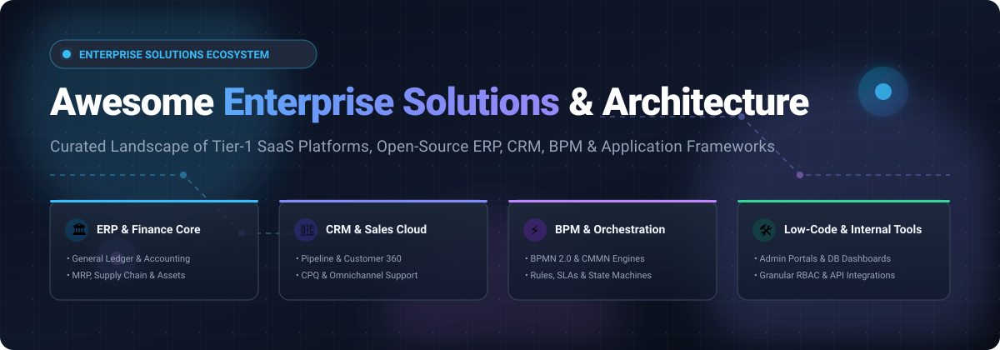
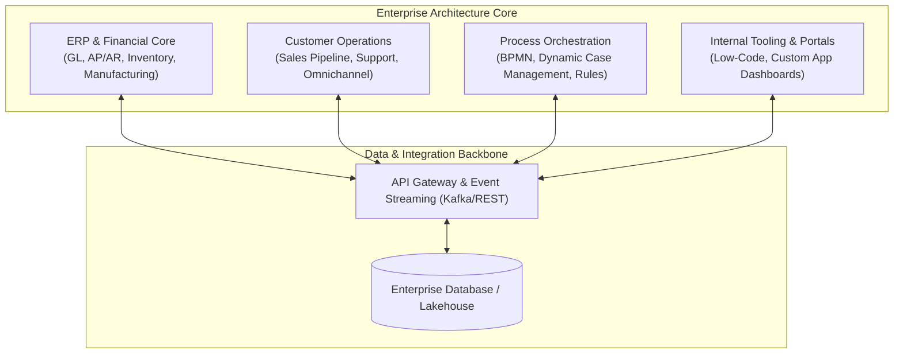

# Awesome Enterprise Solutions & Architecture 🏢⚡

  

  
  
  
  
  
  

> 🚀 **A curated directory of premier enterprise SaaS platforms, hyperscale cloud software suites, and open-source GitHub frameworks for enterprise solutions architecture, ERP, CRM, BPM, low-code systems, and digital transformation.**

This repository tracks foundational platforms and frameworks used by enterprise architects, CIOs, and engineering leaders to run mission-critical operations. It covers both hyperscale commercial SaaS platforms and production-ready open-source alternatives that ensure data sovereignty, zero per-seat licensing penalties, and full architectural flexibility.

---

## 📑 Table of Contents

- [📊 Sector Overview & Market Dynamics](#-sector-overview--market-dynamics)
- [☁️ Enterprise SaaS & Hosted Platforms](#️-enterprise-saas--hosted-platforms)
- [🔓 Open-Source Enterprise Projects](#-open-source-enterprise-projects)
  - [⭐ Open-Source Solutions Ranking](#-open-source-solutions-ranking)
  - [⚖️ Architecture Comparison & Selection Framework](#️-architecture-comparison--selection-framework)
- [🏛️ Key Enterprise Architecture Domains](#️-key-enterprise-architecture-domains)
- [🤝 How to Contribute](#-how-to-contribute)
- [🌟 Star History](#-star-history)
- [💖 Support](#-support)
- [⚠️ Disclaimer](#️-disclaimer)

---

## 📊 Sector Overview & Market Dynamics

The global enterprise software market is valued at approximately **$650 Billion to $720 Billion**, expanding at a compound annual growth rate (CAGR) of **10% to 12.5%** driven by enterprise cloud modernization, automated workflows, and agentic AI integration.

The market displays a dual-structure dynamic: it is **heavily concentrated at the macro core suite layer** (where tech giants like Microsoft, SAP, Oracle, and Salesforce dominate mission-critical ERP, CRM, and financial backbones with massive switching costs), yet **moderately-to-highly fragmented across functional sub-sectors** (such as specialized workflow orchestration, niche BPM, vertical SaaS, and modern developer-first internal tooling), where agile point-solutions and self-hosted open-source frameworks compete aggressively against legacy vendor lock-in.

---

## ☁️ Enterprise SaaS & Hosted Platforms

The table below outlines leading enterprise SaaS and business application suites, sorted in descending order by company scale (market capitalization / valuation):

| Product | Company Valuation / Market Cap | Starting Pricing Tier | Free Tier Limits / Free Trial | Key Strengths & Focus |
|:---|:---|:---|:---|:---|
| **[Microsoft Dynamics 365](https://dynamics.microsoft.com/)** 💼 | **~$3.89 Trillion** *(Market Cap)* | **$70/user/month** (Business Central Essentials); Sales Professional from **$65/user/month** | **30-day free trial** with access to sample company data and live environment evaluation; demo sandboxes available indefinitely | Deep integration with Microsoft 365, Azure, Power Platform, and enterprise Copilot AI. |
| **[Oracle Cloud Applications](https://www.oracle.com/cloud/)** 🌐 | **~$385 Billion** *(Market Cap)* | **$175/user/month** (Financials Self-Service); Core ERP Cloud from **$625/hosted named user/month** | **30-day trial with $300 cloud credits** on Oracle Cloud Infrastructure (OCI) + Always Free OCI tier; ERP application sandboxes provisioned via sales proof-of-concept (PoC) | Mission-critical financial management, global supply chain (SCM), and Autonomous Database infrastructure. |
| **[SAP SE](https://www.sap.com/)** 🏭 | **~$280 Billion** *(Market Cap)* | **$50/user/month** (SAP Business One Cloud Starter); SAP Build from **$3.45/user/month**; Core S/4HANA scoped by Full Use Equivalent (FUE) | **90-day free trial** for SAP Business Technology Platform (BTP); **30-day trial** for SAP Build; SAP BTP Free Tier available indefinitely with Pay-As-You-Go account | Industry gold standard for Fortune 500 manufacturing, logistics, finance, and end-to-end ERP operations. |
| **[Salesforce Enterprise](https://www.salesforce.com/)** ☁️ | **~$185 Billion** *(Market Cap)* | **$25/user/month** (Salesforce Starter Suite, billed annually); Enterprise Edition from **$165/user/month** | **30-day free trial** for Starter/Pro Suite (up to 10 users, no credit card required); Developer Edition orgs free forever with 5MB data and 2 developer licenses | Dominant global CRM platform with extensive AppExchange ecosystem, Customer 360, and Agentforce automation. |
| **[ServiceNow](https://www.servicenow.com/)** ⚡ | **~$120 Billion** *(Market Cap)* | **~$70 – $100/fulfiller/month** (ITSM Standard); end-users/requesters are free | **Free Personal Developer Instance (PDI)** provided indefinitely for developers (hibernates after 24 hours of inactivity; reclaimed if inactive for 10 consecutive days); 100% free on-demand courses via Now Learning | Enterprise service management, ITIL service desk operations, enterprise workflow orchestration, and CMDB. |
| **[Workday](https://www.workday.com/)** 👥 | **~$48 Billion** *(Market Cap)* | **~$35 – $100 PEPM** (Per Employee Per Month based on total organizational headcount; entry enterprise contracts start at ~$100,000/year) | **30-day free trial** for *Workday Adaptive Planning*; core HCM and Financial Management offer no self-service free tier (evaluated via guided sales PoC) | Cloud-native Human Capital Management (HCM), global payroll, and financial management for large distributed workforces. |
| **[Infor CloudSuite](https://www.infor.com/)** 📦 | **~$13 Billion** *(Valuation - Koch Industries)* | **~$150/user/month** (CloudSuite Industrial / SyteLine, typically 5-user minimum); LN/M3 from ~$200/user/month | No public self-service free tier or trial sandbox; hands-on product walkthroughs and sandbox trials arranged via certified partner scoping | Deeply specialized ERP suites tailored for discrete manufacturing, distribution, food & beverage, and healthcare. |
| **[Pegasystems](https://www.pega.com/)** 🔄 | **~$5.2 Billion** *(Market Cap)* | **~$100/user/month** (Case Management / Automation); alternative case-volume pricing from **$0.25 to $0.80 per case** | **30-day free trial** of Pega Community Edition (extendable once for 15 days, up to **45 days total**); full App Studio and Dev Studio access with no credit card required | Low-code process automation, decision management, and AI-driven customer journey workflows for high-volume transactions. |

---

## 🔓 Open-Source Enterprise Projects

Open-source enterprise solutions provide organizations with **complete data sovereignty**, auditable codebase security, seamless extensibility, and elimination of compounding per-seat SaaS licensing costs.

### ⭐ Open-Source Solutions Ranking

The following curated repositories are sorted in descending order by **GitHub Stars_Count**:

| Solution | GitHub_Stars | Primary Stack | Domain / Focus | Key Features & Architecture |
|:---|:---|:---|:---|:---|
| **[NocoDB](https://github.com/nocodb/nocodb)** 📊 |  | Node.js / Vue.js | No-Code Smart Database / Airtable Alternative | Connects directly to existing databases (PostgreSQL, MySQL, SQL Server) and turns them into a collaborative smart spreadsheet and business database with granular access control and REST APIs. |
| **[Twenty](https://github.com/twentyhq/twenty)** 🤝 |  | TypeScript / React / NestJS | Modern Open-Source CRM | Modern, extensible CRM designed as a true open-source alternative to Salesforce. Offers custom object modeling, GraphQL/REST APIs, webhooks, and slick developer-first ergonomics. |
| **[Odoo Community](https://github.com/odoo/odoo)** 🌐 |  | Python / PostgreSQL / JS | Full Modular ERP & Business Suite | World's most widely adopted open-source ERP. Features 80+ official applications and 50,000+ community modules across CRM, billing, manufacturing, inventory, and point of sale. |
| **[ERPNext](https://github.com/frappe/erpnext)** 💼 |  | Python (Frappe) / MariaDB | Comprehensive All-in-One ERP | 100% open-source enterprise suite with zero paywalled features. Ships with built-in financial accounting, HR/payroll, asset management, and complete manufacturing MRP (BOM, work orders). |
| **[Appsmith](https://github.com/appsmithorg/appsmith)** 🛠️ |  | Java / TypeScript / React | Enterprise Low-Code Internal Tooling | Low-code platform for building complex enterprise admin panels, workflows, and dashboards. Integrates with SQL, NoSQL databases, and internal REST/GraphQL services with SSO and audit logs. |
| **[ToolJet](https://github.com/ToolJet/ToolJet)** 🚀 |  | TypeScript / Node.js / React | Low-Code Business App Builder | Extensible developer platform for assembling custom internal tools, operations dashboards, and CRM extensions with built-in integrations, JS query runners, and granular RBAC. |
| **[Budibase](https://github.com/budibase/budibase)** ⚡ |  | Svelte / TypeScript / Node.js | Low-Code Enterprise Workspace | Fast application builder optimized for internal tools, automated forms, client portals, and approval processes. Connects to PostgreSQL, MySQL, REST APIs, and air-gapped internal systems. |
| **[Activiti](https://github.com/activiti/activiti)** ⚙️ |  | Java / Spring Boot | Cloud-Native BPMN Business Process Engine | Light, high-performance BPMN 2.0 workflow and decision engine designed for scalable microservices architectures and distributed enterprise business process automation. |
| **[Flowable](https://github.com/flowable/flowable-engine)** 🔄 |  | Java / Spring | Business Process & Case Management (BPMN / CMMN) | Production-tested enterprise workflow, dynamic case management (CMMN), and decision rules (DMN) engine capable of orchestrating mission-critical transactional pipelines. |
| **[Dolibarr ERP CRM](https://github.com/Dolibarr/dolibarr)** 📈 |  | PHP / MariaDB / PostgreSQL | Lightweight ERP & CRM | Modular, highly accessible ERP and CRM suited for small-to-midsize enterprises, non-profits, and freelancers. Simple zero-dependency LAMP deployment with modular feature switches. |
| **[SuiteCRM](https://github.com/salesagility/SuiteCRM)** 🎯 |  | PHP / Symfony | Enterprise Customer Relationship Management | Established enterprise open-source CRM alternative to SugarCRM and Salesforce. Features sales pipeline management, customer service helpdesk, workflow rules, and marketing campaigns. |
| **[Camunda 7 / Platform](https://github.com/camunda/camunda)** 🧭 |  | Java / Spring Boot / Zeebe | End-to-End Process Orchestration | Enterprise platform for orchestrating complex end-to-end human and microservice workflows using BPMN 2.0 and DMN 1.3 standards. |
| **[Frappe CRM](https://github.com/frappe/crm)** 💬 |  | Python / Vue.js | Modern Open-Source CRM | Clean, reactive modern CRM built on the Frappe framework. Natively unifies leads, deals, email integrations, and communications with the ERPNext accounting core. |
| **[EspoCRM](https://github.com/espocrm/espocrm)** 📋 |  | PHP / Backbone.js / MariaDB | Fast Lightweight SPA CRM | Single-page application CRM focusing on responsiveness and clean REST API integrations. Provides sales automation, customer portals, calendar sync, and Kanban opportunity boards. |
| **[Apache OFBiz](https://github.com/apache/ofbiz-framework)** 🏛️ |  | Java / Apache-2.0 | Custom Enterprise Automation Framework | Mature enterprise-grade foundation for creating custom ERP suites, warehouse management (WMS), and B2B eCommerce pipelines tailored to complex corporate data models. |
| **[iDempiere](https://github.com/idempiere/idempiere)** 🏢 |  | Java / OSGi / PostgreSQL | Multi-Tenant Business Suite | Successor to ADempiere and Compiere. Features native multi-tenant, multi-organization, multi-currency support, financial accounting, supply chain, and manufacturing for complex conglomerates. |
| **[Tryton](https://github.com/tryton/tryton)** 🛡️ |  | Python / PostgreSQL | High-Integrity Modular ERP Framework | Strict three-tier modular architecture designed for auditability and accounting fidelity. Prioritizes API stability, double-entry financial controls, and highly regulated industries. |

---

### ⚖️ Architecture Comparison & Selection Framework

| Requirement / Archetype | Recommended Solution | Architectural Trade-Off |
|:---|:---|:---|
| **All-in-One Out-of-the-Box ERP** | **ERPNext** | Complete un-gated functionality (ERP, HR, MRP); requires familiarity with Python Frappe ecosystem. |
| **Maximum Module Ecosystem** | **Odoo Community** | Unmatched breadth (50k+ apps); some advanced accounting and inventory routes reserved for enterprise tier. |
| **Modern High-Velocity CRM** | **Twenty** or **Frappe CRM** | Fast modern tech stack (TypeScript/Vue); newer ecosystem than legacy PHP CRM suites. |
| **Internal Tools & Portal Builder** | **Appsmith** or **ToolJet** | Rapid UI compilation over Postgres/APIs; requires maintaining self-hosted worker architecture. |
| **Audit-Critical Double-Entry Accounting** | **Tryton** | Strict mathematical accounting model and clean module separation; smaller community module market. |
| **Microservice & BPMN Orchestration** | **Flowable** or **Camunda** | Industrial-grade BPMN/CMMN compliance; steeper learning curve and Java application footprint. |

---

## 🏛️ Key Enterprise Architecture Domains

Modern Enterprise Solutions Architecture organizes capabilities into clean operational pillars:

1. **Enterprise Resource Planning (ERP):** Systems of record for general ledger, double-entry bookkeeping, multi-entity reconciliation, procurement, asset lifecycle, and supply chain management.
2. **Customer Relationship Management (CRM):** Systems of engagement managing customer touchpoints, lead qualification, CPQ (Configure, Price, Quote), and support desk SLAs.
3. **Business Process Management (BPM) & Orchestration:** State machines and workflow execution engines that govern multi-department approval gates and automated human-in-the-loop tasks.
4. **Low-Code Internal Tooling & Extension Frameworks:** Fast UI presentation layers that let engineering teams expose safe operational controls to business users without manual boilerplate code.

---

## 🤝 How to Contribute

Contributions are welcome! Help keep this enterprise directory accurate, exhaustive, and up-to-date:

1. **Fork the repository** to your GitHub account.
2. **Add or modify entries** in `README.md` following the table schema (include official links, factual descriptions, starting price or GitHub Stars_Badges).
3. **Ensure neutrality**: Keep descriptions factual, architecture-focused, and free of sales marketing fluff.
4. **Submit a Pull Request** with a clear explanation of changes.

---

##  Star History

---

## 💖 Support

Thank you for exploring and utilizing the **Awesome Enterprise Solutions & Architecture** repository! 

If this curated guide has brought value to your architectural evaluations, engineering strategy, or platform benchmarking, please consider supporting the project:

- ⭐ **Star this repository** to help other architects, engineers, and tech leaders discover it.
- 🍴 **Fork and contribute** your domain expertise or suggest new additions.
- 📢 **Share** with your network, engineering teammates, and enterprise architecture communities.
- ☕ **Sponsor / Buy a coffee**: If you'd like to back ongoing open-source curation and maintenance, support directly on the [GitHub Sponsors Dashboard](https://github.com/sponsors/ishandutta2007).

---

## ⚠️ Disclaimer

- This directory is a **community-curated guide** intended for informational and architectural research purposes; it does not constitute formal endorsement.
- All enterprise software deployments handling financial data, customer PII, or intellectual property must satisfy statutory regulatory requirements (including SOC 2, ISO 27001, GDPR, HIPAA, and SOX).
- Vendor pricing, license tiers, and API policies are subject to ongoing change by their respective copyright holders. Always verify contractual terms directly with vendors prior to procurement.

---

  <b>Built with pride for enterprise architects, solutions engineers, and technology leaders.</b> 
  ⭐ Star this repository if you find it helpful for your enterprise technology stack decisions!

